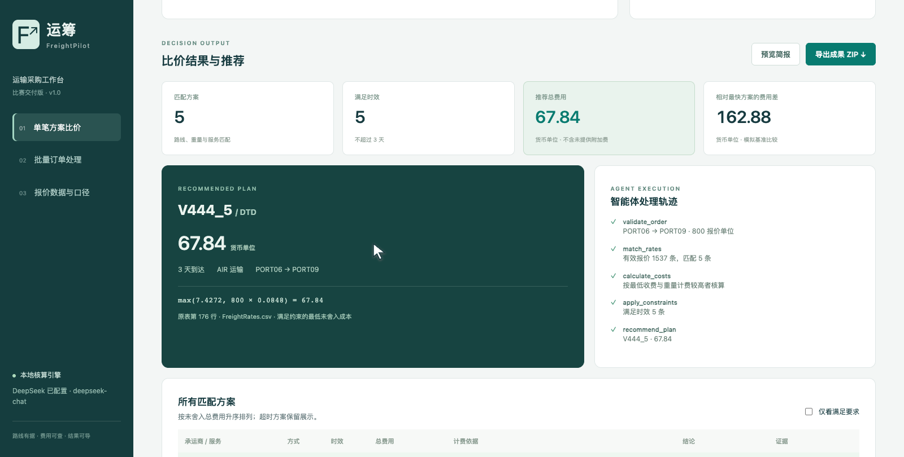

# 运筹 FreightPilot

运输方案比价与优化智能体。根据订单的路线、重量、服务与时效，匹配比赛报价，精确核算费用，推荐满足约束的最低成本方案，并交付可追溯的采购简报。

> 比赛附件含 1,540 行，去掉 3 条完全重复报价后保留 1,537 条。演示订单为模拟订单；费率商业真实性、币种及重量单位未获得外部验证。

## 立即使用

下载 [最新 Release](https://github.com/ShanHuiSir/freight-pilot/releases/latest) 中适合系统的可执行产品。启动后打开本机浏览器，无需 Python；离线可完成全部比价、批量处理和导出。Windows 为 x64，macOS 为 Apple Silicon arm64。关闭控制台结束服务。

源码运行需要 Python 3.10+：

```bash
python -m pip install -r requirements.txt
python app.py
```

默认地址是 `http://127.0.0.1:8899`。端口冲突时使用 `python app.py --port 8900`。macOS 可双击 `启动.command`，Windows 可运行 `启动.bat`（需要 Python）。

## 真实可验证的流程

1. 导入 CSV / XLSX 报价表，或使用内置比赛原表。
2. 手动填写订单，或用自然语言解析需求后核对字段。
3. 依次校验订单、匹配报价、核算费用、应用约束、推荐方案。
4. 查看所有匹配方案、超时原因、费用公式、原表行号和 Pareto 标记。
5. 可选调用 DeepSeek 生成采购简报，导出 XLSX、CSV、HTML、Markdown 和 JSON 运行快照。
6. 批量处理订单并隔离无效与无可行方案的行，生成推荐清单和逐单简报。



## 示例结果

同一模拟订单：重量 `800`，`PORT06 → PORT09`，`DTD`，`AIR`。

| 最大运输天数 | 推荐方案 | 天数 | 费用（货币单位） |
|---|---|---:|---:|
| 3 | V444_5，原表第176行 | 3 | 67.84 |
| 2 | V444_1，原表第548行 | 2 | 68.80 |
| 1 | V444_5，原表第965行 | 1 | 230.72 |
| 0 | 无可行方案 | — | — |

规则：`总费用 = max(Min_Cost, 重量 × Rate)`；最低收费不是附加费。按未舍入 Decimal 金额选最优，展示时四舍五入到两位。区间包含上下端点，订单重量最多两位小数。附加费、税费、体积重、容量、跨单拼单和多段路线不在支持范围。签约前必须确认原表未注明的口径。

## DeepSeek 可选配置

复制 `.env.example` 为 `.env`，设置 `DEEPSEEK_API_KEY`，重启应用。模型仅负责字段提取和文字解释，金额及推荐由确定性引擎计算。未配置模型时，固定格式自然语言可本地解析，例如：`800 报价单位，从 PORT06 到 PORT09，3 天内到达，DTD AIR`。模型失败时手动录入和规则计算仍可用。

可执行文件将 `.env` 放在程序所在目录。**API Key 不进入源码、交付整包或公开仓库。** 提交视频中的真实模型调用元数据保存在运行快照中；请求模型名可能与 API 返回的模型别名不同，按响应记录。

## 交付与验证

- [演示视频与解说词](delivery/)：有声 MP4、同步字幕、口语化解说词和说明。
- [使用及部署文档](docs/使用与部署.md)。
- [方案设计与赛题验收映射](docs/方案设计与验收.md)。
- [数据口径与能力边界](docs/数据口径与能力边界.md)。
- [验证证据](docs/验证记录.json)：测试结果、实际模型调用和实际导出。
- Release：提交整包、完整源码、Windows/macOS 可执行程序。

```bash
python -m unittest discover -s tests -v
python -m pip install -r requirements-desktop.txt
python scripts/build.py
python scripts/smoke_executable.py
```

GitHub Actions 在 Ubuntu 运行测试，在 Windows 打包并实测可执行程序的启动、报价和 XLSX 导出；macOS arm64 产品在本机打包并通过同样的可执行程序验收。

本项目源码采用 MIT 许可；比赛提供的报价数据单独保留其原始权属，见 [NOTICE](NOTICE.md)。
